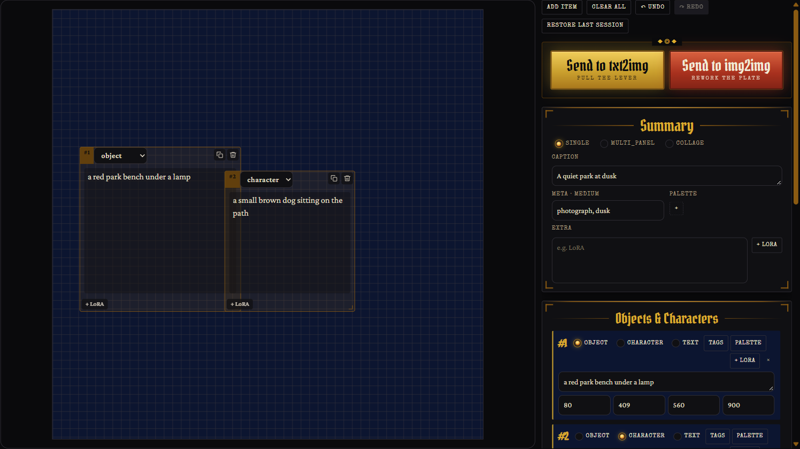

# MOSS Layout

A layout editor for **MOSS-Image** in [Forge Neo](https://github.com/Haoming02/sd-webui-forge-classic/tree/neo).
Draw boxes on a canvas, describe each one, and send the finished layout prompt to txt2img or img2img.

It grew out of Forge Neo's built-in **JSON Builder** and runs in its own **MOSS Layout** tab, so the two can sit side by side.

## Install

1. In Forge Neo open **Extensions → Install from URL**.
2. Paste `https://github.com/SillySilk/sd-forge-moss-layout` and press **Install**.
3. Restart Forge (close it and start it again).

Updates: **Extensions → Installed → Check for updates**.

## What it adds over the built-in JSON Builder

- **Tags and palettes** for the whole image and for each box (MOSS fields, see below).
- **Characters:** save a character once (abbreviation, full name, description, optional tags, palette and LoRAs) in a
  `.jbcast` file; **Add to caption** / **Add to box** put it in the prompt; **Add to box** also puts its LoRAs in that box's caption. On MOSS, Forge's regional LoRA add-on then keeps
  them to that box and to the character's `(ABBR)` line in the Summary caption.
- **Editing:** undo / redo (Ctrl+Z, Ctrl+Y), Delete / arrows / Ctrl+D on the selected box, resize from any side
  (Shift keeps the shape), snapping with guide lines (Alt for free movement), a width/height swap.
- **Size follows txt2img** until you set one by hand; a marker says which, and **Follow txt2img** resumes.
- **Reference image** under the boxes: load a file, drop or paste (Ctrl+V) one onto the canvas, or take txt2img's finished image or img2img's input image (img2img's result if its input is empty; reading the input needs a Forge build that supports it, see Notes).
- **+ LoRA** picker for Extra and for each box.
- **Load the prompt** that is in txt2img back into the editor; **autosave** keeps the last session in the browser.
- **Save JSON / Load JSON** keep layouts in the extension's `JSONscenes/` folder (subfolders allowed); Load opens the Windows Open dialog there.
- **Panel templates:** `JSONscenes/Templates/` has 15 multi-panel page layouts (2 to 5 panels). Each names its panels and says where they sit; fill in the `[FILL IN ...]` parts.
- A **Thing-o-Matic** styled side panel (gold and ember buttons, blackletter titles).

## MOSS-Image fields it writes

| Field | Where | What it does (same-seed test on MOSS) |
|---|---|---|
| `caption` | Summary, each box | The description. |
| `meta` | Summary | Medium / genre words, e.g. `watercolor illustration`. Strong. |
| `canvas` | Summary | `single`, `multi_panel` or `collage`. |
| `palette` | Summary, each box | Up to 8 `#RRGGBB` colours. Weak. |
| `tags` | Each box | Up to 16 keywords. Strong. Each box still needs a caption to send. |
| `text` | Text boxes | The exact words to draw. |

## Your characters stay private

Character files live in `characters/`. Only `examples.jbcast` ships with the extension; every other `.jbcast`
is ignored by git, so updating never overwrites or uploads your own. Deleted files go to `characters/deleted/`.
Saved layouts in `JSONscenes/` are ignored the same way; only `JSONscenes/Templates/` ships.

## Notes

- Needs a Forge Neo with MOSS-Image support (2.31 or later).
- Two extras need additions that stock Forge Neo does not have, and switch themselves off there:
  reading img2img's input image in **From img2img** and putting the reference image into img2img on **Send to img2img** (both need
  `window.forgeCanvasInstances`), and the LoRA folder selector.
- The panel's fonts (Pirata One, Special Elite, Crimson Pro) load from Google Fonts; offline it falls back to system fonts.
- Tests: `node tests/<file>.js` for each JS test, and `python tests/test_characters.py`.

## Credits

- **[Haoming02/sd-webui-forge-classic](https://github.com/Haoming02/sd-webui-forge-classic)** (Forge Neo):
  the original JSON Builder this is built on.
- **[eduardoabreu81/sd-regional-boxes-neo](https://github.com/eduardoabreu81/sd-regional-boxes-neo)**:
  the idea for undo / redo, keyboard shortcuts on the selected box, and resize handles on every
  side came from comparing with this extension. Ideas only; its code was not copied.
- **[DenOfEquity/ersatzForge](https://github.com/DenOfEquity/ersatzForge)**: the idea for a
  one-click width/height swap button. Ideas only; no code was copied.

## License

AGPL-3.0, the same as Forge Neo. See `LICENSE`.
